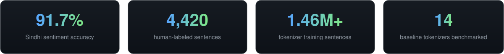

  

  

   &nbsp; &nbsp; &nbsp;

  
  
  
  

  

## 👋 About Me

I'm a Python developer based in Sukkur, Sindh, focused on **applied NLP and language technology for Sindhi**, a low-resource language in the Perso-Arabic script. My work spans the full pipeline: building human-labeled datasets, training tokenizers, fine-tuning transformer models, and shipping the results as SDKs, APIs, and live demos.

I care about **reproducibility and honest evaluation**. My projects document their methodology, benchmark against baselines, and report negative results when the numbers demand it.

<table>
  <tr>
    <td width="50%" valign="top">
      <b>🔬 Now</b> 
      Reproducible <b>Sindhi NLP</b>: sentiment analysis, tokenization, and evaluation benchmarks.
    </td>
    <td width="50%" valign="top">
      <b>🤗 Publishing</b> 
      Models and demos on <b>Hugging Face</b>, a package on <b>PyPI</b>, and a citable release on <b>Zenodo</b>.
    </td>
  </tr>
  <tr>
    <td width="50%" valign="top">
      <b>🛠️ Also building</b> 
      Security-focused web apps (zero-knowledge document sharing), plus compilers, RAG, and computer vision experiments.
    </td>
    <td width="50%" valign="top">
      <b>🎓 Strength</b> 
      Taking projects from research notebook to production deployment.
    </td>
  </tr>
</table>

## 🧰 Tech Stack

<table>
  <tr>
    <td width="22%"><b>Languages</b></td>
    <td>
      
      
      
      
    </td>
  </tr>
  <tr>
    <td width="22%"><b>ML &amp; NLP</b></td>
    <td>
      
      
      
      
      
      
    </td>
  </tr>
  <tr>
    <td width="22%"><b>Web &amp; APIs</b></td>
    <td>
      
      
      
      
      
      
    </td>
  </tr>
  <tr>
    <td width="22%"><b>Tools &amp; Platforms</b></td>
    <td>
      
      
      
      
      
      
      
    </td>
  </tr>
</table>

## Featured Projects

<table>
  <tr>
    <td width="50%" valign="top">
      <h3><a href="https://github.com/alinawazcode/sindhi-nlp">Sindhi NLP</a></h3>
      <b>Reproducible Sindhi sentiment analysis</b>
      
Sentiment analysis for Sindhi with a fine-tuned XLM-RoBERTa model, a Python SDK, and a FastAPI service. Every run is seeded and logs its config, metrics, and data hashes.

      

        
        
        
        
        
      

      

        
        
        
      

    </td>
    <td width="50%" valign="top">
      <h3><a href="https://github.com/alinawazcode/Sindhi_Sentiment_dataset">Sindhi Sentiment Dataset</a></h3>
      <b>Sindhi sentiment classifier and dataset</b>
      
Dual TF-IDF + LinearSVC classifier trained on a fully human-labeled 4,420-sentence dataset: 91.7% accuracy and 0.918 macro F1, with a transparent writeup of why accuracy dropped from v1.

      

        
        
        
        
      

      

        
        
      

    </td>
  </tr>
  <tr>
    <td width="50%" valign="top">
      <h3><a href="https://github.com/alinawazcode/passli">Passli</a></h3>
      <b>Zero-knowledge document sharing</b>
      
High-security document sharing with AES-256-GCM encryption, single-use QR passes, rate-limiting defense, granular expiration controls, and zero server-side plaintext exposure.

      

        
        
        
        
        
      

      

        
        
      

    </td>
    <td width="50%" valign="top">
      <h3><a href="https://github.com/alinawazcode/sindhi-tokenizer">Sindhi Tokenizer</a></h3>
      <b>Corpus-driven subword tokenizer for Sindhi</b>
      
SentencePiece Unigram tokenizer trained on 1.46M+ Sindhi sentences and benchmarked against 14 baseline tokenizers, with a 0.000% normalized-length loss round-trip check.

      

        
        
        
        
      

      

        
        
        
      

    </td>
  </tr>
</table>

  

## 📊 GitHub Statistics

  
  

  

## 🐍 Contribution Snake

  <picture>
    <source media="(prefers-color-scheme: dark)" srcset="https://raw.githubusercontent.com/alinawazcode/alinawazcode/output/github-contribution-grid-snake-dark.svg" />
    <source media="(prefers-color-scheme: light)" srcset="https://raw.githubusercontent.com/alinawazcode/alinawazcode/output/github-contribution-grid-snake.svg" />
    
  </picture>
  Generated automatically every 12 hours by GitHub Actions.

## ⚡ Recent Activity

<b>Latest commits, pull requests and releases</b>

 

<!--START_SECTION:activity-->
1. 🚀 Published release [Sindhi Tokenizer v1.0.0 — First Stable Release](https://github.com/alinawazcode/sindhi-tokenizer/releases/tag/v1.0.0) in [alinawazcode/sindhi-tokenizer](https://github.com/alinawazcode/sindhi-tokenizer)
2. 🎉 Merged PR [#15](https://github.com/alinawazcode/sindhi-nlp/pull/15) in [alinawazcode/sindhi-nlp](https://github.com/alinawazcode/sindhi-nlp)
3. 💪 Opened PR [#15](https://github.com/alinawazcode/sindhi-nlp/pull/15) in [alinawazcode/sindhi-nlp](https://github.com/alinawazcode/sindhi-nlp)
4. 🎉 Merged PR [#14](https://github.com/alinawazcode/sindhi-nlp/pull/14) in [alinawazcode/sindhi-nlp](https://github.com/alinawazcode/sindhi-nlp)
5. 💪 Opened PR [#14](https://github.com/alinawazcode/sindhi-nlp/pull/14) in [alinawazcode/sindhi-nlp](https://github.com/alinawazcode/sindhi-nlp)
6. ❌ Closed PR [#153](https://github.com/abhiksark/pythonlings/pull/153) in [abhiksark/pythonlings](https://github.com/abhiksark/pythonlings)
7. 🎉 Merged PR [#24](https://github.com/alinawazcode/passli/pull/24) in [alinawazcode/passli](https://github.com/alinawazcode/passli)
8. 💪 Opened PR [#24](https://github.com/alinawazcode/passli/pull/24) in [alinawazcode/passli](https://github.com/alinawazcode/passli)
9. 🎉 Merged PR [#23](https://github.com/alinawazcode/passli/pull/23) in [alinawazcode/passli](https://github.com/alinawazcode/passli)
10. 💪 Opened PR [#23](https://github.com/alinawazcode/passli/pull/23) in [alinawazcode/passli](https://github.com/alinawazcode/passli)
<!--END_SECTION:activity-->

Updated automatically every 6 hours by GitHub Actions.

## 🤝 Connect With Me

   &nbsp; &nbsp; &nbsp;
    
  Open to collaboration on Sindhi NLP, low-resource language tooling, and applied ML. Say hello!

  
  Built with Markdown, Shields.io, and GitHub Actions. Everything on this page is generated from real data.

