  

  

  
  
  
  

  

## About Me

I'm a Python developer based in Sukkur, Sindh, focused on **applied NLP and language technology for Sindhi** — a low-resource language in the Perso-Arabic script. My work spans the full pipeline: building human-labeled datasets, training tokenizers, fine-tuning transformer models, and shipping the results as SDKs, APIs, and live demos.

I care about **reproducibility and honest evaluation** — my projects document their methodology, benchmark against baselines, and report negative results when the numbers demand it.

- 🔬 &nbsp;Currently working on reproducible **Sindhi NLP**: sentiment analysis, tokenization, and evaluation benchmarks
- 🤗 &nbsp;Publishing models and demos on **Hugging Face**, a package on **PyPI**, and a citable release on **Zenodo**
- 🛠️ &nbsp;Also building security-focused web applications (zero-knowledge document sharing) and experimenting with compilers, RAG, and computer vision
- 🎓 &nbsp;Comfortable taking projects from research notebook to production deployment

## Tech Stack

**Languages**

  
  
  
  

**Machine Learning & NLP**

  
  
  
  
  
  

**Web, APIs & Apps**

  
  
  
  
  
  

**Tools, DevOps & Platforms**

  
  
  
  
  
  
  

## Featured Projects

  
  

  
  

  
  

## GitHub Statistics

  
  

  

## Contribution Snake

  <picture>
    <source media="(prefers-color-scheme: dark)" srcset="https://raw.githubusercontent.com/alinawazcode/alinawazcode/output/github-contribution-grid-snake-dark.svg" />
    <source media="(prefers-color-scheme: light)" srcset="https://raw.githubusercontent.com/alinawazcode/alinawazcode/output/github-contribution-grid-snake.svg" />
    
  </picture>
  Generated automatically every 12 hours by GitHub Actions.

## Recent Activity

<!--START_SECTION:activity-->
<!--END_SECTION:activity-->

Updated automatically every 6 hours by GitHub Actions.

## Connect With Me

  
  
  
  

 

  Built with Markdown, Shields.io, and GitHub Actions — everything on this page is generated from real data.

