<div align="center">
  
</div>

<div align="center">
  <a href="https://readme-typing-svg.demolab.com/?font=Fira+Code&weight=500&size=20&duration=3200&pause=900&color=60A5FA&center=true&vCenter=true&width=720&height=40&lines=Python+Developer+%C2%B7+ML+%26+NLP+Engineer;Model+training+%C2%B7+Evaluation+%C2%B7+APIs;From+notebook+to+production+deployment"></a>
</div>

<div align="center">
  <a href="https://ali-folio-8qoc.vercel.app/"></a> <a href="https://www.linkedin.com/in/ali-nawaz-786w/"></a> <a href="https://github.com/alinawazcode"></a> <a href="https://huggingface.co/alinawazmahar"></a> <a href="https://pypi.org/project/sindhi-nlp/"></a>
</div>

<p align="center">
  
  
  
  
</p>

<div align="center">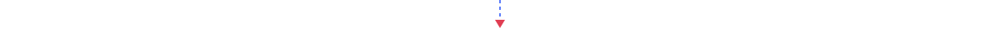</div>

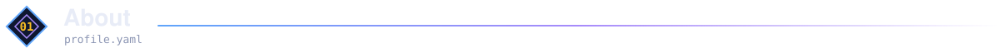

```yaml
# profile.yaml
name: Ali Nawaz
role: Python Developer · ML & NLP Engineer
status: open to opportunities
strengths:
  - fine-tuning and evaluating transformer models
  - shipping models as SDKs, REST APIs and demos
  - secure, tested backends (Django, FastAPI)
how_i_work: [reproducible runs, baselines first, honest reporting]
shipped: [PyPI package, Hugging Face models and Spaces, Dockerized apps, CI pipelines]
```

I'm a Python developer who takes machine learning work from a research notebook to something other people can install, call and trust. I build the whole chain: labeled datasets, training and evaluation, then packaging, APIs and deployment. My NLP projects focus on low-resource languages, which taught me to benchmark carefully and report negative results when the numbers demand it.

<div align="center"></div>

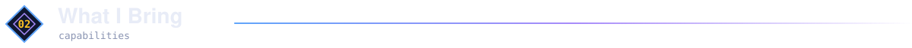

<table>
  <tr>
    <td width="33%" valign="top">
      <h3>🧠 Machine Learning &amp; NLP</h3>
      Fine-tuned XLM-RoBERTa and classical TF-IDF + LinearSVC models, trained tokenizers, and benchmarked against 14 baselines. Seeded, logged runs so results can be reproduced.
    </td>
    <td width="33%" valign="top">
      <h3>⚙️ Backend &amp; APIs</h3>
      FastAPI and Django services, including a zero-knowledge document platform with AES-256-GCM encryption, single-use QR passes and rate limiting.
    </td>
    <td width="33%" valign="top">
      <h3>🚀 Delivery &amp; Quality</h3>
      Docker, GitHub Actions CI, automated tests, a PyPI package, Hugging Face releases and documentation sites, so work ships and stays maintainable.
    </td>
  </tr>
</table>

<div align="center"></div>

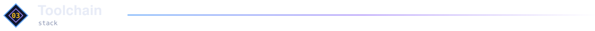

<div align="center">
  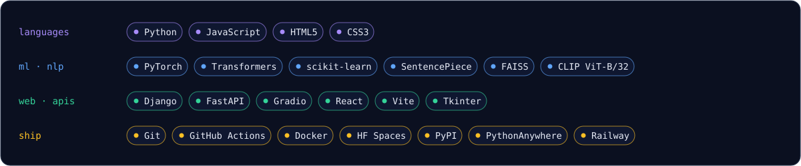
</div>

<div align="center"></div>

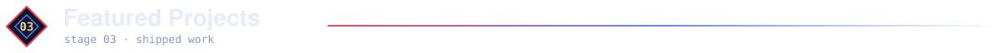

<table>
  <tr>
    <td width="50%" valign="top">
      <h3><a href="https://github.com/alinawazcode/sindhi-nlp">Sindhi NLP</a></h3>
      <b>Transformer sentiment analysis with SDK and API</b>
      <p>Sentiment analysis (Sindhi) with a fine-tuned XLM-RoBERTa model, a Python SDK, and a FastAPI service. Every run is seeded and logs its config, metrics, and data hashes.</p>
      <p>
        
        
        
        
        
      </p>
      <p>
        <a href="https://github.com/alinawazcode/sindhi-nlp"></a>
        <a href="https://huggingface.co/alinawazmahar/sindhi-sentiment-xlmr"></a>
        <a href="https://pypi.org/project/sindhi-nlp/"></a>
      </p>
    </td>
    <td width="50%" valign="top">
      <h3><a href="https://github.com/alinawazcode/Sindhi_Sentiment_dataset">Sindhi Sentiment Dataset</a></h3>
      <b>Classical ML classifier and labeled dataset</b>
      <p>Dual TF-IDF + LinearSVC classifier trained on a fully human-labeled 4,420-sentence dataset: 91.7% accuracy and 0.918 macro F1, with a transparent writeup of why accuracy dropped from v1.</p>
      <p>
        
        
        
        
      </p>
      <p>
        <a href="https://github.com/alinawazcode/Sindhi_Sentiment_dataset"></a>
        <a href="https://huggingface.co/spaces/alinawazmahar/sindhi-sentiment"></a>
      </p>
    </td>
  </tr>
  <tr>
    <td width="50%" valign="top">
      <h3><a href="https://github.com/alinawazcode/passli">Passli</a></h3>
      <b>Zero-knowledge document sharing</b>
      <p>High-security document sharing with AES-256-GCM encryption, single-use QR passes, rate-limiting defense, granular expiration controls, and zero server-side plaintext exposure.</p>
      <p>
        
        
        
        
        
      </p>
      <p>
        <a href="https://github.com/alinawazcode/passli"></a>
        <a href="https://github.com/alinawazcode/passli/tree/main/docs"></a>
      </p>
    </td>
    <td width="50%" valign="top">
      <h3><a href="https://github.com/alinawazcode/sindhi-tokenizer">Sindhi Tokenizer</a></h3>
      <b>Corpus-driven subword tokenizer</b>
      <p>SentencePiece Unigram tokenizer trained on 1.46M+ sentences and benchmarked against 14 baseline tokenizers, with a 0.000% normalized-length loss round-trip check.</p>
      <p>
        
        
        
        
      </p>
      <p>
        <a href="https://github.com/alinawazcode/sindhi-tokenizer"></a>
        <a href="https://huggingface.co/alinawazmahar/sindhi-tokenizer"></a>
        <a href="https://alinawazcode.github.io/sindhi-tokenizer/"></a>
      </p>
    </td>
  </tr>
</table>

<div align="center">
  <a href="https://github.com/alinawazcode?tab=repositories"></a><a href="https://github.com/alinawazcode"></a>
</div>

<div align="center"></div>

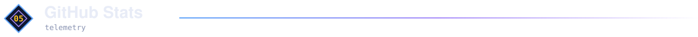

<div align="center">
  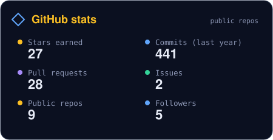
  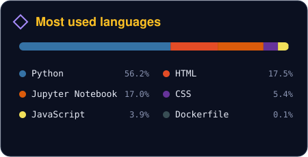
</div>
<div align="center">
  <a href="https://github.com/alinawazcode">
    
  </a>
</div>

<br />

<div align="center">
  <picture>
    <source media="(prefers-color-scheme: dark)" srcset="https://raw.githubusercontent.com/alinawazcode/alinawazcode/output/github-contribution-grid-snake-dark.svg" />
    <source media="(prefers-color-scheme: light)" srcset="https://raw.githubusercontent.com/alinawazcode/alinawazcode/output/github-contribution-grid-snake.svg" />
    
  </picture>
  <sub>Contribution snake, generated every 12 hours by GitHub Actions.</sub>
</div>

<div align="center"></div>

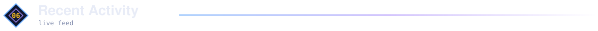

<details open>
<summary><b>Latest commits, pull requests and releases</b></summary>
<br />

<!--START_SECTION:activity-->
1. 🚀 Published release [Sindhi Tokenizer v1.0.0 — First Stable Release](https://github.com/alinawazcode/sindhi-tokenizer/releases/tag/v1.0.0) in [alinawazcode/sindhi-tokenizer](https://github.com/alinawazcode/sindhi-tokenizer)
2. 🎉 Merged PR [#15](https://github.com/alinawazcode/sindhi-nlp/pull/15) in [alinawazcode/sindhi-nlp](https://github.com/alinawazcode/sindhi-nlp)
3. 💪 Opened PR [#15](https://github.com/alinawazcode/sindhi-nlp/pull/15) in [alinawazcode/sindhi-nlp](https://github.com/alinawazcode/sindhi-nlp)
4. 🎉 Merged PR [#14](https://github.com/alinawazcode/sindhi-nlp/pull/14) in [alinawazcode/sindhi-nlp](https://github.com/alinawazcode/sindhi-nlp)
5. 💪 Opened PR [#14](https://github.com/alinawazcode/sindhi-nlp/pull/14) in [alinawazcode/sindhi-nlp](https://github.com/alinawazcode/sindhi-nlp)
6. ❌ Closed PR [#153](https://github.com/abhiksark/pythonlings/pull/153) in [abhiksark/pythonlings](https://github.com/abhiksark/pythonlings)
7. 🎉 Merged PR [#24](https://github.com/alinawazcode/passli/pull/24) in [alinawazcode/passli](https://github.com/alinawazcode/passli)
8. 💪 Opened PR [#24](https://github.com/alinawazcode/passli/pull/24) in [alinawazcode/passli](https://github.com/alinawazcode/passli)
9. 🎉 Merged PR [#23](https://github.com/alinawazcode/passli/pull/23) in [alinawazcode/passli](https://github.com/alinawazcode/passli)
10. 💪 Opened PR [#23](https://github.com/alinawazcode/passli/pull/23) in [alinawazcode/passli](https://github.com/alinawazcode/passli)
<!--END_SECTION:activity-->

</details>

<sub>Updated automatically every 6 hours by GitHub Actions.</sub>

<div align="center"></div>

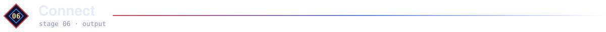

<div align="center">
  <b>Looking for a Python / ML engineer? Let's talk.</b><br />
  <sub>See my work at <a href="https://ali-folio-8qoc.vercel.app/">ali-folio-8qoc.vercel.app</a>, or reach me on LinkedIn.</sub>
  <br /><br />
  <a href="https://ali-folio-8qoc.vercel.app/"></a> <a href="https://www.linkedin.com/in/ali-nawaz-786w/"></a> <a href="https://github.com/alinawazcode"></a> <a href="https://huggingface.co/alinawazmahar"></a> <a href="https://pypi.org/project/sindhi-nlp/"></a> <a href="https://doi.org/10.5281/zenodo.23832590"></a>
</div>

<div align="center">
  
  <sub>Built with Markdown, SVG, and GitHub Actions</sub>
</div>
